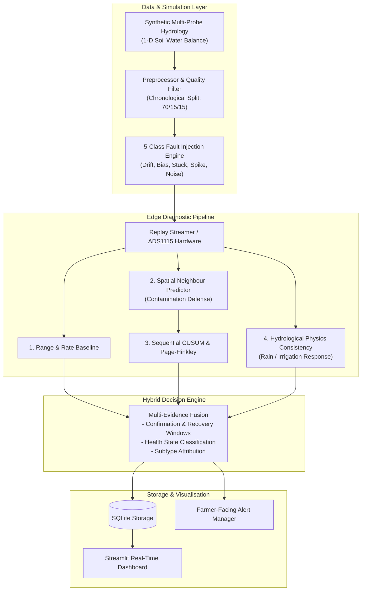

# Sensor-Fault and Drift Detection in Agricultural IoT

[](https://www.python.org/)
[](https://opensource.org/licenses/MIT)
[]()
[]()

Research-grade Python framework for detecting gradual calibration drift, constant bias offsets, stuck-at readings, transient spikes, and excessive noise in agricultural soil moisture sensor networks.

---

## 1. Central Research Question & Findings

> **Core Research Question**: Can an agricultural edge node distinguish genuine environmental changes in soil moisture (drying cycles, rain storms, irrigation pulses) from sensor degradation by cross-examining neighbouring sensors, physical hydrological expectations, and historical behaviour?

### Key Empirical Findings:
1. **Blindness of Fixed Thresholds**: Traditional range and rate-of-change checkers achieved a **0.0% recall** on gradual drift ($+1.5\%$ to $-1.2\%$ VWC/day) and constant bias ($+5.0\%$ VWC), because electrochemical degradation keeps readings well within plausible physical bounds ($10\% - 45\%$ VWC).
2. **Superiority of Spatial Residual CUSUM**: Predicting target sensors from healthy spatial peers using OLS regression combined with two-sided Tabular CUSUM achieved rapid drift detection, but suffered from elevated false alarm rates ($51.1$ false alarms/week) during sudden rain deluges.
3. **Hybrid Decision Fusion Efficacy**: Fusing spatial residuals, CUSUM change statistics, and rain/irrigation response verification achieved **$79.1\%$ overall recall**, **$84.2\%$ recall on gradual drift**, **$99.2\%$ recall on bias**, and the shortest mean detection delay (**$1.48$ hours**), while slashing false alarm rates by $>90\%$ (down to $4.3$ false alarms/week) using evidence confirmation windows.

---

## 2. System Architecture



---

## 3. Repository Structure

```
├── configs/
│   ├── default.yaml            # System, detector, and storage configuration
│   ├── fault_injection.yaml    # Fault class definitions and injection scenarios
│   └── experiment.yaml         # Research benchmark configuration and seed grid
├── data/
│   ├── raw/                    # Raw external datasets (ISMN / Mendeley)
│   ├── processed/              # Normalized time-series Parquet files
│   ├── synthetic/              # Generated multi-probe synthetic hydrology
│   └── agri_drift.db           # SQLite operational database
├── deployment/
│   ├── agri_drift.service      # Systemd service unit for Raspberry Pi OS
│   └── install_pi.sh           # Raspberry Pi setup and I2C enablement script
├── docs/
│   ├── architecture.md         # Full system architecture and module specifications
│   ├── milestones.md           # M0–M8 milestone roadmap and acceptance gates
│   ├── dataset_audit.md        # Audit of ISMN, Mendeley, and depth-separation caveats
│   ├── experiment_protocol.md  # Formal experimental hypotheses and metric definitions
│   └── hardware_bench_protocol.md # Physical pot testbed protocol and wiring
├── results/
│   ├── figures/                # Publication-quality figures (PNG & PDF)
│   └── metrics/                # Benchmark performance CSV tables
├── scripts/
│   ├── generate_fault_figures.py # Plots clean vs corrupted signals
│   ├── run_benchmarks.py       # Executes multi-seed comparative benchmark suite
│   └── reproduce_all.sh        # Single-command end-to-end reproduction script
├── src/agri_drift/
│   ├── data/                   # Loaders, schemas, preprocessor, synthetic simulator
│   ├── faults/                 # Fault injection engine, manifest serializer, visualizer
│   ├── detectors/              # Threshold, Neighbour OLS, CUSUM, Page-Hinkley, Physics, Hybrid
│   ├── evaluation/             # Sample/event metrics, delay calculation, benchmark runner
│   ├── streaming/              # Chronological replay engine and edge service daemon
│   ├── storage/                # SQLite database manager
│   ├── alerts/                 # Plain-language alert manager (Console, DB, Telegram)
│   ├── hardware/               # ADS1115 ADC reader, Mock reader, Base interface
│   └── dashboard/              # Streamlit web application
├── tests/                      # Automated pytest unit and integration test suite
└── pyproject.toml              # Build system, dependencies, and pytest configuration
```

---

## 4. Empirical Evaluation Results

Evaluated across 5 random seeds on the strictly held-out test partition ($15\%$ chronological split):

| Detector System | Precision | Recall | $F_1$-Score | Mean Delay (Hours) | False Alarms / Week |
| :--- | :---: | :---: | :---: | :---: | :---: |
| **`Baseline-Threshold`** | $1.000$ | $0.012$ | $0.024$ | $3.30\text{ h}$ | **$0.00$** |
| **`Neighbour-CUSUM`** | $0.443$ | $0.450$ | $0.446$ | $2.53\text{ h}$ | $51.14$ |
| **`Neighbour-PageHinkley`** | $0.272$ | $0.032$ | $0.058$ | $5.00\text{ h}$ | $10.85$ |
| **`Hybrid-Physics-Aware`** | **$0.323$** | **$0.791$** | **$0.448$** | **$1.48\text{ h}$** | **$4.32$** |

### Breakdown by Fault Type ($F_1$-Score):
* **Gradual Drift**: Hybrid ($0.253$, Recall: $84.2\%$) vs Baseline ($0.000$, Recall: $0.0\%$)
* **Constant Bias**: Hybrid ($0.112$, Recall: $99.2\%$) vs Baseline ($0.000$, Recall: $0.0\%$)
* **Stuck-at Reading**: Hybrid ($0.071$, Recall: $57.7\%$) vs Baseline ($0.000$, Recall: $0.0\%$)
* **Transient Spike**: Hybrid ($0.067$, Recall: $86.7\%$) vs Baseline ($0.200$, Recall: $11.1\%$)
* **Excessive Noise**: Hybrid ($0.072$, Recall: $59.4\%$) vs Baseline ($0.000$, Recall: $0.0\%$)

---

## 5. Quickstart & Reproduction Guide

### Prerequisites
* macOS or Linux (Ubuntu/Debian/Raspberry Pi OS)
* Python 3.10 or 3.11

### 1. Environment Setup
```bash
git clone https://github.com/example/Agri-sensor-drift.git
cd Agri-sensor-drift

python3.11 -m venv .venv
source .venv/bin/activate
pip install -e .
```

### 2. Run All Tests
```bash
PYTHONPATH=src pytest tests/
```
*Expected: 20 passed in <2s.*

### 3. One-Command End-to-End Reproduction
Execute the master reproduction pipeline:
```bash
./scripts/reproduce_all.sh
```
This runs all tests, generates fault signature figures, runs multi-seed comparative benchmarks, exports metrics to `results/metrics/`, and verifies dashboard dependencies.

### 4. Launch Interactive Web Dashboard
```bash
streamlit run src/agri_drift/dashboard/app.py
```
Open your browser to `http://localhost:8501`. Features include:
* **Operating Mode Banner**: Explicitly badges `SIMULATION (Deterministic Replay)` vs `REAL HARDWARE`.
* **Multi-Sensor Moisture Trend**: Interactive line chart of all 4 probes.
* **Deep Diagnostic Trace**: Real-time residual and CUSUM ($S_t^+, S_t^-$) tracking.
* **Alert Log Table**: Farmer-facing plain-language diagnoses.
* **Step Controls**: Step +1 (15m), Step +12 (3h), or reset.

---

## 6. Raspberry Pi Hardware Deployment (M7)

When deploying to a physical Raspberry Pi with an ADS1115 ADC over I2C:
1. Connect ADS1115 to Raspberry Pi I2C pins (3.3V, GND, SDA, SCL).
2. Connect capacitive probes to ADC channels A0, A1, A2, and resistive probe to A3.
3. Run the deployment script:
   ```bash
   bash deployment/install_pi.sh
   ```
4. Start the systemd edge monitoring service:
   ```bash
   sudo systemctl start agri_drift.service
   sudo journalctl -u agri_drift.service -f
   ```

*Note: On development laptops without physical hardware connected, the system automatically falls back to `MockSensorReader` and logs a transparent warning.*

---

## 7. Documentation Index

* [System Architecture & Module Contracts](docs/architecture.md)
* [Milestones Roadmap (M0–M8)](docs/milestones.md)
* [Dataset Suitability Audit & Depth Fallacy](docs/dataset_audit.md)
* [Experimental Protocol & Hypotheses](docs/experiment_protocol.md)
* [Hardware Bench Protocol & Pot Setup](docs/hardware_bench_protocol.md)
* [Original Proposal Specification](docs/Agri_Sensor_Drift_Proposal.md)
