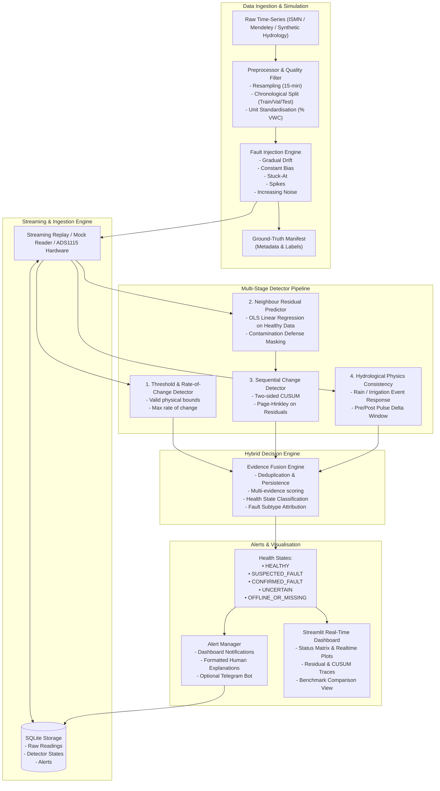

# System Architecture and Data-Flow Design
## Sensor-Fault and Drift Detection in Agricultural IoT

### 1. Executive Technical Summary

Low-cost agricultural IoT deployments (particularly capacitance and resistance-based soil moisture probes) are vulnerable to electrochemical corrosion, biofouling, dielectric drift, mechanical disconnection, and transient electrical disturbances. Traditional threshold-based range checks fail to detect insidious gradual drift and subtle calibration offsets because the degraded measurements remain within plausible physical bounds (e.g., 10%–45% Volumetric Water Content, VWC).

This system provides an end-to-end, edge-capable, research-grade software architecture that diagnoses sensor faults by cross-examining:
1. **Spatial Consistency**: Predictions from neighbouring sensor streams calibrated on healthy historical intervals.
2. **Sequential Drift Statistics**: Cumulative Sum (CUSUM) and Page–Hinkley change-point detection on neighbour prediction residuals.
3. **Physical Hydrological Dynamics**: Expected moisture responses following verified rainfall or irrigation pulses.
4. **Statistical Boundary and Rate baselines**: Range validity and instantaneous persistence/rate-of-change checks.

The software runs fully on commodity laptop hardware in simulation mode (deterministic replay and synthetic hydrological models) and supports physical deployment on a Raspberry Pi via an ADS1115 16-bit I2C ADC without requiring code modification.

---

### 2. End-to-End System Architecture

---

### 3. Detailed Module Breakdown

#### 3.1 Data Loading and Preprocessing (`src/agri_drift/data/`)
* **Purpose**: Ingest diverse hydrological datasets (ISMN, Mendeley, synthetic), enforce schema validation, handle missing timestamps, apply linear interpolation/forward-fill within bounded gaps, convert raw units to standardized Volumetric Water Content (% VWC), and partition data chronologically.
* **Key Components**:
  - `schema.py`: Pydantic / dataclass schema definitions for multi-sensor time-series and event records.
  - `loader.py`: CSV and Parquet loaders with provenance tracking and metadata retention.
  - `preprocessor.py`: Temporal alignment, regular grid resampling (e.g., 15-minute or 1-hour intervals), quality-flag filtering, and leakage-free chronological splitting (Train $\rightarrow$ Validation $\rightarrow$ Test).
  - `synthetic_generator.py`: Physically plausible soil moisture simulation based on bucket drainage models, diurnal evapotranspiration, and stochastic rain/irrigation pulses with realistic spatial correlation across adjacent sensor probes.

#### 3.2 Fault Injection Engine (`src/agri_drift/faults/`)
* **Purpose**: Inject 5 precisely parametrized fault classes into healthy sensor series to generate repeatable ground-truth benchmark datasets.
* **Fault Classes**:
  1. *Gradual Sensor Drift*: Linear drift specified in physical units (e.g., $+0.5\%$ to $+2.0\%$ VWC per day or $-1.0\%$ VWC per day).
  2. *Constant Bias Offset*: Step offset added continuously ($\pm 3\%$ to $\pm 15\%$ VWC).
  3. *Stuck-at Readings*: Sensor output clamped to a constant value (e.g., previous value, 0.0, or maximum scale) for a defined duration.
  4. *Transient Spike Faults*: Short duration anomalous impulses of single or few samples.
  5. *Excessive / Increasing Measurement Noise*: Zero-mean Gaussian or heteroscedastic noise with increasing standard deviation $\sigma(t)$.
* **Key Outputs**: Corrupted time series, ground-truth binary label masks ($y_t \in \{0, 1\}$), fault class identifiers, and structured JSON/YAML manifests.

#### 3.3 Detection Algorithms (`src/agri_drift/detectors/`)
* **`threshold.py`**:
  - Checks if reading $x_t \notin [VWC_{min}, VWC_{max}]$ (e.g. $[2.0\%, 55.0\%]$).
  - Checks if $|x_t - x_{t-1}| > \Delta_{max}$ given the sampling interval $\Delta t$.
* **`neighbour.py`**:
  - For each target sensor $i$, fits an Ordinary Least Squares (OLS) model: $\hat{x}_{i,t} = \beta_0 + \sum_{j \neq i} \beta_j x_{j,t}$ using strictly healthy training data.
  - Computes residual: $r_{i,t} = x_{i,t} - \hat{x}_{i,t}$.
  - Includes **Contamination Defense**: If sensor $j$ is currently flagged as faulty, it is dynamically masked out of reference sets to prevent error propagation.
* **`cusum.py`**:
  - Implements two-sided tabular CUSUM on standardized residuals $z_t = (r_t - \mu_0)/\sigma_0$:
    $$S_t^+ = \max(0, S_{t-1}^+ + z_t - k), \quad S_t^- = \max(0, S_{t-1}^- - z_t - k)$$
  - Flags drift when $S_t^+ > h$ or $S_t^- > h$, where $k$ is allowance and $h$ is decision threshold.
* **`page_hinkley.py`**:
  - Implements Page–Hinkley change detection on raw/standardized residuals with cumulative deviation tracking and configurable threshold $\lambda$.
* **`physics.py`**:
  - Ingests logged rain/irrigation timestamps.
  - Monitors a post-event response window $[t_{event}, t_{event} + \tau_{window}]$ (e.g., 2–6 hours).
  - Checks whether $\Delta VWC = \max(VWC) - VWC(t_{event}) \ge \delta_{min}$. If non-responsive while neighbours respond, accumulates a physics suspicion score.

#### 3.4 Hybrid Decision Engine (`src/agri_drift/detectors/hybrid.py`)
* **Purpose**: Integrate signals from all detectors into an interpretable health state and classify fault subtypes.
* **Health States**:
  - `HEALTHY`: Consistent with neighbours, within physical limits, and responsive to hydrological inputs.
  - `SUSPECTED_FAULT`: CUSUM/Page–Hinkley trigger or physics inconsistency detected; persistence counter active.
  - `CONFIRMED_FAULT`: Persistent divergence beyond confirmation window (or independent ground truth confirmation).
  - `UNCERTAIN`: High residual but multiple neighbours also diverging (e.g., localized unrecorded watering event or anomalous environmental shock).
  - `OFFLINE_OR_MISSING`: Complete loss of signal or persistent NaN values.
* **Subtype Classification**:
  - Immediate large jump with zero variance $\rightarrow$ `STUCK_AT`
  - High residual variance without mean shift $\rightarrow$ `NOISE`
  - Single/isolated residual excursion returning immediately $\rightarrow$ `SPIKE`
  - Sustained monotonic residual accumulation with CUSUM trigger $\rightarrow$ `DRIFT`
  - Step shift in residual with sustained level $\rightarrow$ `BIAS`

#### 3.5 Storage and Streaming (`src/agri_drift/storage/` & `src/agri_drift/streaming/`)
* **SQLite Database**: Schema includes `readings` (raw voltage, calibrated VWC, timestamp, sensor_id), `detector_states` (residual, CUSUM statistics, active flags), and `alerts` (severity, subtype, human message).
* **Streaming Engine**:
  - `ReplayStreamer`: Reads historical or synthetic data chronologically at configurable speeds ($1\times, 10\times, 100\times$, or step-by-step), feeding readings into the stateful detector pipeline.
  - Decoupled from hardware: Identical API whether fed by `ReplayStreamer`, `MockSensorReader`, or `ADS1115SensorReader`.

#### 3.6 Hardware Adapter Layer (`src/agri_drift/hardware/`)
* **`base.py`**: Abstract base class `SensorReader` defining `read_channel(channel: int) -> Tuple[float, float]` (raw voltage, calibrated moisture).
* **`ads1115_reader.py`**: Interacts with the ADS1115 ADC over I2C using `adafruit-circuitpython-ads1x15`. Protected by graceful import handling so code runs smoothly on non-Pi laptops.
* **`mock_reader.py`**: Simulates ADS1115 16-bit voltage registers (0.0V–3.3V) and soil probe transfer functions with synthetic noise and fault injection capabilities for automated CI testing.

#### 3.7 Evaluation Framework (`src/agri_drift/evaluation/`)
* Computes metrics:
  - Precision, Recall, F1-Score (per fault type and aggregated).
  - Mean Detection Delay (hours between fault injection start and first alert).
  - False Alarms per Sensor-Week on uncorrupted baseline data.
  - Confusion matrices and ROC/PR curves.
* Produces publication-ready figures (PNG & vector PDF) and summary CSV tables.

#### 3.8 Dashboard and Alerting (`src/agri_drift/dashboard/` & `src/agri_drift/alerts/`)
* **Streamlit UI**:
  - System Mode Banner (`SIMULATION (Replay)` vs `REAL HARDWARE (ADS1115)`).
  - Sensor health cards with colour-coded status pills.
  - Multi-sensor synchronous time-series graphs with irrigation/rain markers.
  - Real-time residual and CUSUM tracking plots.
  - Alert log table with severity, fault type, and explainability text.
* **Alert Delivery**:
  - Local logging / console alerts.
  - Structured database alert queue.
  - Optional Telegram Bot webhook / API adapter (requiring non-committed environment variables).

---

### 4. Input / Output Data Contracts

| Component | Input Format | Output Format | Primary Dependencies |
| :--- | :--- | :--- | :--- |
| **Data Preprocessing** | Raw CSV / Parquet time series | Normalized Parquet / pandas DataFrame with standard columns (`timestamp`, `sensor_id`, `vwc_percent`, `rain_mm`, `irrigation_flag`) | `pandas`, `numpy`, `pyyaml` |
| **Fault Injection** | Clean DataFrame, Fault Config | Corrupted DataFrame + Ground-Truth Manifest (`fault_id`, `sensor_id`, `fault_type`, `t_start`, `t_end`, `params`) | `numpy`, `dataclasses` |
| **Detectors** | Streamed reading tuple $(t, \text{sensor\_id}, x_t)$ | Detection record with raw residuals, statistics ($S_t^+, S_t^-$), and individual detector booleans | `scikit-learn`, `numpy` |
| **Hybrid Fusion** | Detector output collection | Health State enum, Subtype string, Explanation string | Pure Python |
| **Storage Engine** | Health decision, reading tuple | SQLite relational rows (`readings`, `states`, `alerts`) | `sqlite3` |
| **Evaluation** | Predictions DataFrame & Ground-Truth Manifest | Metrics dictionary, CSV reports, Matplotlib PNG/PDF plots | `scikit-learn`, `matplotlib` |
| **Dashboard** | SQLite DB connection / live queue | Interactive Web UI (Streamlit components) | `streamlit` |
